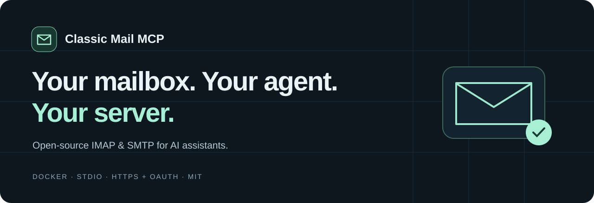

<p align="center"></p>

<p align="center">
  <a href="https://github.com/Mihanikuz/classic-mail-mcp-exchange/actions/workflows/ci.yml">CI</a> ·
  <a href="LICENSE">MIT license</a> ·
  <a href="docs/exchange-claude.md">Exchange &amp; claude.ai guide</a> ·
  <a href="docs/README.de.md">Deutsch</a> ·
  <a href="docs/deployment.md">Deployment</a> ·
  <a href="docs/security.md">Security model</a>
</p>

**A self-hosted MCP server for the IMAP/SMTP or Microsoft Exchange mailbox you already have.**
Connect an AI assistant — including **claude.ai** as a custom connector — to search and read email, inspect attachments, and, for IMAP/SMTP mailboxes when explicitly enabled, send messages, manage drafts and organize folders.

Built for people whose mail provider does not offer an AI integration. Run it on your computer with Docker, on your own server, or on Google Cloud Run. Every installation belongs to **one operator**, with up to ten configured mailboxes.

> Public preview. Automated tests cover the protocol and security boundaries; provider compatibility and client sign-in must still be verified on your installation. This project has not had an independent security audit.

## What this fork adds

This is a fork of [kapitelh/classic-mail-mcp](https://github.com/kapitelh/classic-mail-mcp). The original IMAP/SMTP server, its security model and its tools are unchanged. On top of it:

| Addition                               | What it gives you                                                                                                                                                                                                                                      |
| -------------------------------------- | ------------------------------------------------------------------------------------------------------------------------------------------------------------------------------------------------------------------------------------------------------ |
| **Microsoft Exchange (EWS) backend**   | Read-only access to Exchange mailboxes through Exchange Web Services over HTTPS — the same channel Outlook uses. Works when IMAP is disabled or blocked. Enable with `MAIL_BACKEND=ews`.                                                               |
| **claude.ai custom connector support** | Connect from claude.ai on the web, Claude Desktop and Claude mobile with Google sign-in: the claude.ai OAuth callback and origin are allowed, `resource` is accepted as `BASE_URL/mcp`, and the consent page can redirect to Google after **Approve**. |
| **Compose fix**                        | `tmpfs` syntax that recent Docker Compose versions rejected (`invalid mount path: 'mode=1777'`).                                                                                                                                                       |
| **Deployment guide**                   | Exchange + claude.ai setup, including running behind an MTProto (Telegram) proxy that already occupies port 443, and troubleshooting: [English](docs/exchange-claude.md) · [Русский](docs/exchange-claude.ru.md).                                      |

## What it does

| Read-only (default, IMAP and Exchange)    | Read-write (opt-in, IMAP/SMTP only)     |
| ----------------------------------------- | --------------------------------------- |
| List accounts and folders                 | Send, reply, reply-all and forward      |
| Search mail with pagination               | Save and send drafts                    |
| Read without changing unread state        | Move, copy, archive and trash           |
| Download attachments in bounded chunks    | Manage folders and read/starred flags   |
| Check mailbox credentials without sending | Explicitly confirmed permanent deletion |

Six tools are available by default; all **21 tools** become available with `ACCESS_MODE=read-write` on the IMAP/SMTP backend. The Exchange backend is **read-only by design**: it contains no write operations and is only activated together with `ACCESS_MODE=read-only`. [Complete tool reference →](docs/tools.md)

- TLS certificate validation for every mailbox connection.
- IMAP 993 / SMTP 465 with implicit TLS; IMAP 143 / SMTP 587 with **mandatory STARTTLS**.
- Exchange Web Services over HTTPS (`https://<host>/EWS/Exchange.asmx`), redirects refused.
- OAuth with Google sign-in for remote clients (claude.ai, ChatGPT); bearer authentication for local HTTP; stdio for local MCP clients.
- Persistent send history prevents automatic duplicate submissions when the same idempotency key is retried.
- No mailbox passwords, bearer tokens or mail bodies in application logs.
- SQLite with persistent disk locally; Firestore for multiple Cloud Run instances.

## Choose a connection

| Your situation                              | Transport                                    | Authentication                 | Storage                                                |
| ------------------------------------------- | -------------------------------------------- | ------------------------------ | ------------------------------------------------------ |
| Desktop client that can launch Docker       | stdio                                        | Local process access           | SQLite volume                                          |
| Desktop client with an HTTP MCP endpoint    | Streamable HTTP on localhost                 | Random bearer token            | SQLite volume                                          |
| claude.ai, ChatGPT or another remote client | Streamable HTTP over public HTTPS (port 443) | Google OAuth + owner allowlist | SQLite on a persistent host, or Firestore on Cloud Run |

Google sign-in authenticates **you to this MCP**. It does not grant Gmail access. Your configured IMAP/SMTP or Exchange credentials authenticate to your mail provider separately.

## Choose a mail backend

| Your mailbox                                             | Backend                          | Setting                                        |
| -------------------------------------------------------- | -------------------------------- | ---------------------------------------------- |
| IMAP/SMTP with password or app password                  | IMAP/SMTP (default)              | `MAIL_BACKEND=imap` or unset                   |
| Microsoft Exchange where Outlook works but IMAP does not | Exchange Web Services, read-only | `MAIL_BACKEND=ews` and `ACCESS_MODE=read-only` |

To check whether your Exchange server exposes EWS, request it without credentials — `401` means EWS is there:

```sh
curl -s -o /dev/null -w "%{http_code}\n" https://mail.example.com/EWS/Exchange.asmx
```

## Quick start: local Docker

Requirements: Docker with Compose, Python 3 for the private setup wizard, and an IMAP/SMTP or Exchange account that permits password or app-password authentication.

```sh
git clone https://github.com/Mihanikuz/classic-mail-mcp-exchange.git
cd classic-mail-mcp-exchange
python3 scripts/setup.py
docker compose up --build -d
```

For **Exchange**, answer the wizard with the Exchange host (the one serving `/EWS/Exchange.asmx`) as IMAP host with port 993, the same host as SMTP host with port 465 (SMTP is not used by the EWS backend), then add `MAIL_BACKEND=ews` to `.env` before starting.

The wizard hides passwords and generates independent random keys. It creates `.secrets/config.json`, `.data/` and `.env`. These are excluded from Git and Docker builds. The default Compose service binds **only to 127.0.0.1:8080**.

Open [the local service page](http://127.0.0.1:8080). In your MCP client, use:

| Setting        | Value                                                         |
| -------------- | ------------------------------------------------------------- |
| Name           | `classic-mail`                                                |
| Type           | Streamable HTTP                                               |
| URL            | `http://127.0.0.1:8080/mcp`                                   |
| Authentication | Bearer token from `bearerToken` in your private configuration |

If your client asks for a **bearer-token environment variable**, enter a variable name such as `CLASSIC_MAIL_TOKEN`, not the token itself. Set that variable in the environment used to launch your client. A GUI app may not inherit variables from your terminal. The Google OAuth client secret is never a bearer token. [Client examples →](docs/clients.md)

Then ask your agent:

1. “List the accounts available through Classic Mail.”
2. “Check the connection for account mail1.”
3. “Show the latest five messages in INBOX without marking them as read.”

A healthy service page is not proof of a working mailbox. These checks verify discovery, credentials and an actual read.

### Enable sending and management (IMAP/SMTP only)

Set `ACCESS_MODE=read-write` in `.env`, then:

```sh
docker compose up -d
```

Refresh the tool list in your client. Configure the client to request confirmation for sending and destructive operations. Server descriptions cannot enforce a human approval dialog in arbitrary clients. All connected clients for this operator share access to the same configured accounts. With `ACCESS_MODE=read-write` the IMAP/SMTP backend is always used, even if `MAIL_BACKEND=ews` is set.

### Local stdio

Use the same private configuration or run the wizard with `--mode stdio`. Build once:

```sh
docker build -t classic-mail-mcp:local .
```

Configure your MCP client to launch the Docker command documented in [client setup](docs/clients.md). Use `-i`, **never `-t`**, and mount both configuration and persistent data. No HTTP port is exposed in stdio mode.

## Deploy with OAuth

[Deployment guide →](docs/deployment.md) covers a persistent Docker host with an HTTPS reverse proxy and a two-stage Google Cloud Run setup script. You need your **own** cloud project, Google OAuth web client, credentials and allowed sign-in identity. There is no shared hosted mailbox service.

## Connect claude.ai

1. Deploy with OAuth (`python3 scripts/setup.py --mode oauth`, `AUTH_MODE=oauth`, `BASE_URL=https://mcp.example.com`). The Google OAuth redirect URI is `https://mcp.example.com/oauth/callback`.
2. Serve it over HTTPS on the **standard port 443** — claude.ai does not connect to custom ports.
3. In claude.ai: **Settings → Connectors → Add custom connector**, URL `https://mcp.example.com/mcp`. Leave client ID and secret empty: the server supports dynamic client registration.
4. **Connect** → consent page → **Approve** → sign in with the Google account from the allowlist.

Step-by-step instructions, including a reverse proxy behind an MTProto proxy on port 443 and fixes for common errors: [docs/exchange-claude.md](docs/exchange-claude.md).

## Provider support

Any provider with standard IMAP/SMTP **password or app-password** authentication and a valid TLS certificate can be configured. Credentials may have a separate SMTP username/password. Hostnames are supplied by the operator, not by tools.

Microsoft Exchange is supported read-only through EWS with **Basic authentication** (username and password over HTTPS). Exchange Online / Microsoft 365 tenants that require modern authentication (OAuth) for EWS are not supported.

The automated suite uses synthetic IMAP, SMTP, EWS and OAuth responses. It does not certify individual providers. Accounts requiring provider OAuth/XOAUTH2 (for example some Microsoft or Google configurations), local plaintext mail bridges, custom ports and enterprise SSO are not implemented. Check your provider's current requirements before installing.

## Limits you should know

- Raw message: 8 MiB. Downloaded attachment: 4 MiB, in 128 KiB chunks. Read text: 50,000 characters.
- IMAP: a search page scans at most 10,000 UIDs. Follow `nextBeforeUid` even if a page is empty.
- Exchange: `nextBeforeUid` is an offset for the next page. Date, unread, subject and text filters run on the server; sender and recipient filters are applied to results (up to 1,000 messages scanned per call). Folders are addressed as `INBOX` or by the path returned by `list_folders`.
- Folder restrictions are exact matches. Special folders may need explicit configuration.
- SMTP acceptance is not recipient delivery. Sent-folder copying can fail separately.
- Never retry an uncertain send with a new idempotency key. Inspect the provider's Sent folder first.
- The server connects to existing mailboxes; it does not host incoming SMTP, run a background inbox watcher or provide push notifications.
- No multi-user isolation: run a separate instance and storage for each person.

## Development

Node.js 24, npm, Python 3 and OpenSSL are used by the checks.

```sh
npm ci
npm run check
docker build -t classic-mail-mcp:local .
```

See [configuration](docs/configuration.md), [architecture](docs/architecture.md), [troubleshooting](docs/troubleshooting.md), [contributing](CONTRIBUTING.md) and [security reporting](SECURITY.md).

Original project by [kapitelh](https://github.com/kapitelh). Exchange (EWS) backend and claude.ai support by [Mihanikuz](https://github.com/Mihanikuz). Released under the [MIT license](LICENSE).
