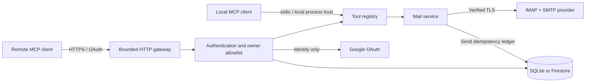

# Architecture

- `config.ts`: strict operator configuration, provider hosts, modes and secret loading.
- `server.ts`: transport lifecycle, HTTP request limits, bearer authentication and security headers.
- `auth.ts`: OAuth proxy, browser binding, PKCE, callback policy and token-purpose checks.
- `tools.ts`: input schemas, tool annotations, read-only filtering and sanitized results.
- `mail.ts`: bounded IMAP reads, MIME composition, safe mutations and SMTP send state handling.
- `store.ts` / `sqlite.ts`: OAuth state, rate limits and persistent send claims.
- `connection-check.ts`: credential verification without sending.
- `ui.ts`: static service landing page without account data or external scripts.

Both storage backends implement atomic authorization-state consumption and send claims. SQLite serializes local transactions; Firestore supports shared state across Cloud Run instances. OAuth upstream-token storage is encrypted by FastMCP before reaching the backend. Never substitute an in-memory production send ledger.

## Send state

A send starts with a persistent `in_progress` claim. The same key with a different payload is rejected. SMTP timeout/error leaves an uncertain result. If SMTP accepts, that receipt is persisted before an optional Sent-folder append. A later append error does not trigger another SMTP submission.

A crash between SMTP submission and durable receipt cannot be resolved automatically. The client must inspect provider state rather than submit with a new key. This is deliberate: silently retrying can send duplicate messages.

## Tests

The suite includes real SDK sessions over HTTP and stdio, full mocked Google OAuth exchanges, a real local TLS IMAP server, STARTTLS refusal tests and injected SMTP mutation tests. No test sends an internet email or uses production credentials. Firestore transaction behavior is exercised through an in-memory test adapter; a real Cloud Firestore deployment remains an operator acceptance check.
